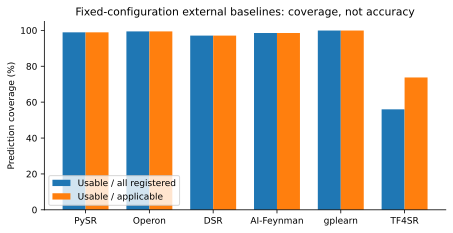
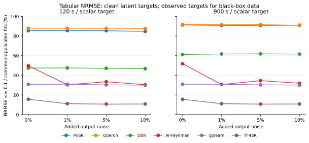
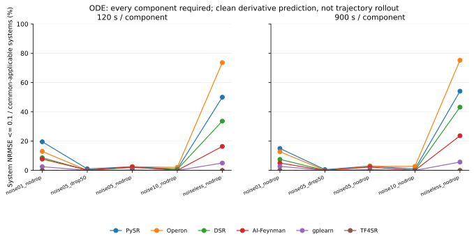

# 六种外部符号回归方法的 Benchmark 报告

本报告整理 B7 固定配置评测及 2026-10-27 范围扩展的结果，为后续 MySR 横向比较提供题库、结果和复现依据。当前结果不包含 MySR。报告按实际采用的版本、配置、预算和资源条件描述结果，不将这些配置称为各方法的全局最优配置。

## 1. 评测范围与结果完整性

评测对象为 PySR、Operon、DSR、AI-Feynman 2.0、gplearn 和 TF4SR。完整矩阵有 **221,400 个标量拟合记录**；每个方法 36,900 个。它们对应 151,200 个表格拟合槽位和 37,800 个 ODE 系统槽位。ODE 系统的每个导数分量独立拟合，因此系统槽位数与标量拟合数不同。

最终汇总包括 **202,878 条有可用预测的记录、9,642 条适用但无可用预测的记录，以及 8,880 条不适用记录**。有终态不等于拟合成功。超时记录只要留下了验证集选定且可在测试集上有限评分的模型，就可以贡献预测指标，同时保留超时状态。

| 方法 | 注册记录 | 适用记录 | 有可用预测 | 适用但无可用预测 | 不适用 |
|---|---:|---:|---:|---:|---:|
| PySR | 36,900 | 36,900 | 36,494 | 406 | 0 |
| Operon | 36,900 | 36,900 | 36,685 | 215 | 0 |
| DSR | 36,900 | 36,900 | 35,820 | 1,080 | 0 |
| AI-Feynman 2.0 | 36,900 | 36,900 | 36,357 | 543 | 0 |
| gplearn | 36,900 | 36,900 | 36,860 | 40 | 0 |
| TF4SR | 36,900 | 28,020 | 20,662 | 7,358 | 8,880 |

“有可用预测”要求已选定表达式，并具有有限、非负的训练、验证和测试误差；它不表示预测足够准确，也不表示恢复了真实公式。方法顺序为注册顺序，不是排名。最终审计和范围扩展见 [metadata](metadata/)；完整逐项指标及原结果字节哈希见 [evidence](evidence/)。

## 2. 题库、噪声与重复实验

实际使用的表格题共有 **315 道**：经典题库 51 道，SRBench 黑箱题 12 道，SRBench 已知机制题 12 道，SRSD-Feynman 120 道，以及对应的干扰变量题 120 道。这是本次冻结的实际子集，不是完整 SRBench 数据集的所有任务。

每道表格题使用 clean、output_noise_01、output_noise_05、output_noise_10 四种数据版本，两档预算和十个搜索种子。新增输出噪声按训练目标标准差标定。黑箱题的测试观测值在各噪声版本中保持不变，不声明真实公式恢复。

ODE 部分有 **63 个系统、5 种条件**：无噪声，1%、5%、10% 噪声，以及 5% 噪声并移除 50% 点。训练目标由预先固定的轨迹处理规则构造，测试使用独立干净轨迹的导数目标。它评测的是导数预测，不是积分后的轨迹恢复、动力学稳定性或长期外推。

十个搜索种子为 `23654, 15795, 860, 5390, 16850, 29910, 4426, 21962, 14423, 28020`。表格数据版本与 ODE 分量合计形成 **1,845 个标量数据实例、5,535 个 CSV 划分文件**。精确数据哈希和来源见 corpus 元数据及本地冻结输入包的验证回执。

## 3. 预算、数据处理与模型选择

当前生效的协议是 [`common-cpu-train-scale-v2`](metadata/comparison-protocol.json)。两档搜索预算分别为每个标量目标 **120 秒**和 **900 秒**；ODE 每个导数分量分别获得该预算。没有统一的评估次数上限或内存上限。历史 `resource-policy-v1.json` 中的评估次数与内存设置不属于本次 B7 的生效预算。

导入和合成数据编译预热与搜索分开记录；数据相关的优化、常数拟合和解码属于搜索；导出、候选验证与测试评分单独记录。搜索超时及已有候选的无新增搜索恢复均保留。TF4SR 使用一次固定的贪心解码，不通过重复解码填满时间预算。

数据处理仅使用训练集的输入和观测目标，按最大绝对值作乘法缩放，不中心化；角度弧度列保持原尺度。预测和表达式导出映射回原始单位。候选按验证 MSE、原生复杂度、表达式文本依次选择。测试数据在冻结候选之后评分，不根据测试结果更换模型。

## 4. 软件版本与固定设置

| 方法 | 实际安装版本／源码依据 | 本轮主要设置 |
|---|---|---|
| PySR | Python 包 2.0.0b3；Julia 1.10.3；SymbolicRegression.jl 2.0.0-beta.8 | Float64；31 个种群，每群 27；maxsize=30；原生 CSV 运算顺序导出 |
| Operon | PyOperon 0.6.1；原生 rev. 5a1c937，float32 单精度构建 | 种群 1,000；LM 常数优化 10 次；MSE 与长度双目标；单线程 |
| DSR | PyTorch 实现提交 `85f88faf…`；PyTorch 2.3.1 | batch_size=100；普通算子；不启用 GP meld；记录实际执行后端 |
| AI-Feynman | aifeynman 2.0.7；PyTorch 2.2.2+cpu | 14ops；多项式次数 3；NN_epochs=100；不从输入中划出内部测试集 |
| gplearn | 0.4.2 | 种群 1,000；MSE；原生保护性除法、log、sqrt；普通 exp |
| TF4SR | 源码提交 `2cd6748b…`；PyTorch 2.3.1；权重 SHA 单独保存 | 固定预训练权重；一次带合法性掩码的贪心解码；最多 30 token；共享正常数 C 在训练集拟合 |

完整依赖版本见 [`installed-versions.json`](metadata/installed-versions.json)，上游源码提交见 [`upstream-source-lock.json`](metadata/upstream-source-lock.json)，环境锁见 [environments](environments/)。安装包版本与另行检出的源码提交不是同一种证据，不能相互替代。

这是按共同名义搜索预算运行的原生方法比较。不同方法的算子保护语义、语法、复杂度定义、评估计数和预训练条件不同，不能称为完全相同搜索空间的比较。尤其不能把某些原生统计中的评估计数 0 解释为算法没有计算；评估次数仅作带原始语义的描述，不用于跨方法等算量结论。

TF4SR 为预训练方法，预训练公式与题库的重叠尚未审计。其结果需作为预训练方法单列解释，不能据此声明“从未见过公式”的恢复能力。所有方法均未提供等规模超参数优化的证据，本报告不声称其为充分调优后的能力上限。

## 5. 原 B7、续跑与范围扩展

原 B7 的完整审计保留了 20,980 条不适用记录。后续只依据题库范围和训练输入条件选出 12,100 条可原样运行的项目补跑：AI-Feynman 黑箱题 960 条，TF4SR 非原注册题型 11,140 条。补跑不改变输入列、数据字节、搜索种子、模型权重或搜索参数；不根据测试成绩决定是否补跑。

范围扩展中有 7,898 条有可用预测，4,202 条没有可用预测，全部保留。本报告的扩展汇总在预先选定的原 NA 槽位中使用补跑结果，包括负面结果；不在多次测试成绩之间选最好的一次。原 B7 审计和扩展审计同时提供，可以分别复算。

剩余 8,880 条均属于 TF4SR 原生输入条件不满足：2,720 条超过六个输入变量，6,160 条不足 50 个全部输入为正且目标非零的训练行。没有删掉输入变量来使模型勉强适配。这些项目表示覆盖范围限制，不应直接计为 MySR 在预测精度上战胜该方法。

## 6. 计算资源条件

运行节点使用双路 AMD EPYC 9754，共 256 个物理核、512 个逻辑核。每个拟合固定在一个逻辑 CPU 上，Python、Julia、BLAS、OpenMP 和 PyTorch 的相关线程设置有记录。没有使用 GPU。

| 运行阶段 | 并发条件 | 汇总中保留的来源 |
|---|---|---|
| 原 B7 | 128 个物理核池，每次拟合一个线程 | job 35055；扩展汇总保留 195,102 条 |
| 缺失项续跑 | 374 个逻辑核池，包含 SMT 共享物理核 | job 36320；共续跑 15,818 条，扩展汇总保留 14,198 条 |
| 原 NA 范围扩展 | 128 个物理核池，每次拟合一个线程 | job 36559；12,100 条记录 |

Slurm 作业未设时限、mem=0、不自动重排；单项科学搜索预算仍为 120/900 秒。常驻内存（RSS）是进程树采样值，不是预留内存，也不是全节点内存用量。耗时包括的阶段见原始字段，不把总耗时直接视为纯搜索时间。

同时多线程（SMT）允许多个逻辑 CPU 共享一个物理核。续跑中的一个逻辑 CPU 不等于原运行中的独占物理核。汇总保留逐条 resource_epoch；后续 MySR 需要匹配对应的硬件条件，或分层分析。任务模板会为确需两种条件的标量案例分别列出 MySR 运行条件，当前并未执行这些模板。

续跑记录中有 1,620 个原 NA 槽位后来获得了范围扩展结果，因此扩展汇总中的 SMT 记录数少于续跑实际提交数。按最终保留的外部结果，严格匹配两种资源条件需要 **38,554 个 MySR 模板请求**：物理核条件 35,904 个，SMT 条件 2,650 个；其中 1,654 个标量案例需要两种条件。模板数量不等于新增题目数，也不是已运行的 MySR 结果。

## 7. 指标、分母与图表

NRMSE 定义为 `sqrt(MSE) / max(std(target), 1e-15)`。已知真实目标的表格抗噪声任务，以干净潜在目标的测试分数作为主指标；黑箱题以保持不变的观测目标评分；ODE 以独立干净轨迹的导数目标评分。带噪声观测值上的分数同时保存，不能与干净目标分数混用。原完成审计中的 test_nrmse 对应观测目标，本报告从已保存的 test_clean_score 另行复算主指标。

主表报告预测覆盖率和 NRMSE 达到 `1e-6、1e-4、0.01、0.1、1、10` 的比例，分母包含所有注册适用项目；无效输出和没有模型的超时项目留在分母中。条件中位数只描述有可用预测的子集，必须同时看覆盖数量。另提供六方法共同适用的 28,020 个标量案例，避免把不同方法自己的适用子集混作相同题库。

表格任务与 ODE 系统分别呈现。ODE 的系统指标要求全部分量都有可用预测，再对各分量 NRMSE 作宏平均；不能只平均成功的分量。原生表达式复杂度不是跨方法统一的公式长度，也没有完成统一的符号等价恢复判定。

- [完整分层表](tables/)：整体、表格／ODE 分量、题库家族、噪声、预算、资源条件、共同适用集及 ODE 系统指标。
- [配对案例目录](tables/paired-case-catalog.csv)：逐案例数据哈希、预算和各方法资源条件。
- [ODE 系统结果](tables/ode-system-results.csv)：37,800 个系统记录，保留不适用和失败。
- [统计汇总与模板数量](tables/summary.json)。

SVG 与 PDF 均可独立使用。覆盖率图同时显示全部注册项目和各方法自身适用项目的分母；两张精度曲线图采用六方法共同适用的表格项目／完整 ODE 系统，分母包含其中的失败。各方法完整适用范围的结果另见 CSV。图表是本轮固定配置的描述性结果，不包含 MySR 的性能结论或方法普遍优越性的推断。

### 7.1 共同适用题目上的描述性数值摘要

下表将两档预算、所有噪声版本及十个种子汇总；分母固定为六方法共同适用的 20,960 个表格拟合槽位或 4,300 个完整 ODE 系统槽位。失败仍在分母中。资源阶段和题族的分层结果须同时保留，不能把这个汇总当成普遍排名。

共同适用仅对齐题目和分母，不自动对齐 CPU 共享条件。本表和精度曲线仍是跨资源阶段的描述性汇总；严格资源匹配的比较须使用逐项 resource_epoch 分层或对应的 MySR 配对模板。

| 方法 | 表格 NRMSE ≤ 0.1 | ODE 系统宏平均 NRMSE ≤ 0.1 |
|---|---:|---:|
| PySR | 18469 / 20960（88.12%） | 648 / 4300（15.07%） |
| Operon | 18783 / 20960（89.61%） | 812 / 4300（18.88%） |
| DSR | 11403 / 20960（54.40%） | 421 / 4300（9.79%） |
| AI-Feynman 2.0 | 7676 / 20960（36.62%） | 253 / 4300（5.88%） |
| gplearn | 6400 / 20960（30.53%） | 73 / 4300（1.70%） |
| TF4SR | 2526 / 20960（12.05%） | 0 / 4300（0.00%） |

这些结果显示，预测覆盖率和误差达标率需要分别看待。例如 gplearn 的有限预测覆盖率很高，但在当前共同题集上的误差达标比例明显更低。TF4SR 在这些新增 ODE 条件下没有系统达到本表阈值；这属于当前固定预训练模型、输入范围和解码设置的结果，不能推广为所有 Transformer 符号回归方法的结论。

## 8. 后续 MySR 比较的使用方式

使用同一冻结数据、划分、数据版本、搜索种子及预算，记录 MySR 的版本、参数、训练来源和全部失败。MySR 也按验证集选择表达式，并采用相同的干净／观测目标评分和失败分母规则，不获取真实公式或测试反馈。

[`mysr-run-template.jsonl.gz`](tables/mysr-run-template.jsonl.gz) 提供案例及资源条件模板，不含已选定的 MySR 超参数，也不是现有六方法 worker 可以直接执行的 MySR 适配器。需要在 MySR 开跑前冻结设置，记录它是否已使用这些题目或测试结果进行开发和调参。当前材料不能证明这些测试数据从未参与 MySR 开发。

比较时按案例键、预算和资源条件连接结果；同时报告全注册覆盖率、各方法适用集和共同适用集。对 ODE 保留系统层面统计，避免分量数较多的系统获得额外权重。若以后报告显著性或误差区间，应以题目／系统为分析单位并说明随机种子的嵌套关系，不将重复种子当成独立题目。

## 9. 复现材料与保存边界

[复现说明](REPRODUCE.md) 区分表格与图形复算、精确输入验证、单项原生方法重跑三个层次。仓库包含逐项结果元数据、表达式、评分、版本、配置、源码、环境锁和哈希。完整候选／前沿、预测数组、控制台日志、原始输入和环境二进制档案保留在外部版本化存储，不把“仅克隆本仓库”描述为已具备全部大体积运行资产。

本地冻结输入包会逐项匹配全部 5,535 个 CSV 的原请求哈希，并独立解压回读。原始数据没有因打包而删除。第三方数据的公开再分发仍遵守原题库的逐项许可审查，不由“仓库公开”推导许可。必要的本地位置清单不提交到 GitHub。

已有的 JSON 清理只允许去除字符串外的排版空白，并检查完整解码内容、候选数量、原始数值文本以及最终结果／前沿／预测文件哈希。成功、失败、超时和非最终入选候选均不能因为结果已完成而删除。报告发布后的清理回执会单独记录实际释放空间、验证范围和保留事项。

需要保留一项历史限制：更早的一次清理移除了 543 个截断的暂存片段，虽保留了完整对应文件，但当时没有证明片段内容是完整文件的子集。因此不声称这些片段已恢复，也不声称全部中断写入历史均无损保留。当前 221,400 条终态结果、选定模型及评分的完整审计与这项历史片段限制分开报告。

报告状态以完整导出、表格复算及发布验证回执为准；不以 Slurm COMPLETED 代替科学结果质量。当前 `formal_comparison_ready=false`；MySR 对应结果、资源匹配和最终比较审阅尚未完成。
